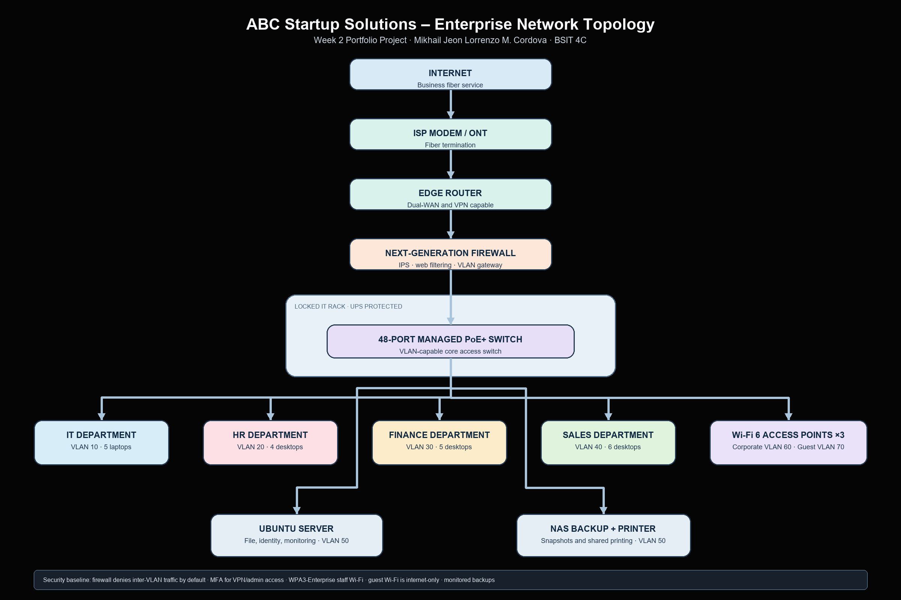

# Week 2 – Enterprise Infrastructure Planning for a Startup Company

## Student Information

| Information | Details |
|---|---|
| **Student** | Mikhail Jeon Lorrenzo Mercado Cordova |
| **Program / Section** | BSIT 4C |
| **Course** | ITEP 414 – System Administration and Maintenance |
| **Project** | Enterprise Infrastructure Plan |
| **Date** | October 31, 2026 |
   
---

## Project Overview

This portfolio artifact presents the initial IT infrastructure plan for **ABC Startup Solutions**, a new software-development company with 20 employees occupying one office floor. The plan turns business needs into a practical, secure, and scalable environment before equipment is purchased. It covers the organization, endpoint and network inventories, a logical topology, system-administration roles, security and backup recommendations, and implementation priorities.

## Learning Objectives

- Analyze the technology needs of a small organization.
- Prepare clear hardware, software, and network inventories.
- Design a logical and segmented enterprise network.
- Document infrastructure decisions professionally using Markdown.
- Explain how system-administration roles work together.

---

# Part 1 – Company Profile

## Organization

| Item | Details |
|---|---|
| **Company name** | ABC Startup Solutions |
| **Nature of business** | Custom web, mobile, and business software development for local small and medium enterprises. |
| **Vision** | To be a trusted Philippine technology partner that makes reliable digital services accessible to growing businesses. |
| **Mission** | To design, build, and support secure software through collaborative teams, disciplined engineering, and responsive client service. |
| **Office location** | 3rd Floor, Innovation Hub, Santa Cruz, Laguna, Philippines *(fictional)* |
| **Operating model** | One office floor, cloud-enabled development, and secure remote support when approved. |

## Organizational Structure

```text
Managing Director
├── Information Technology Manager
│   └── IT Department (5)
├── Human Resources Manager
│   └── Human Resources (4)
├── Finance Manager
│   └── Finance (5)
└── Sales Manager
    └── Sales (6)
```

## Employee Distribution

| Department | Employees | Primary technology need |
|---|---:|---|
| Information Technology | 5 | Development tools, virtual machines, administrative access, and test resources |
| Human Resources | 4 | Office productivity, employee records, and secure printing |
| Finance | 5 | Accounting applications, confidential financial files, and reliable backup |
| Sales | 6 | CRM access, presentations, e-mail, and meeting connectivity |
| **Total** | **20** | Secure, reliable access to business systems |

---

# Part 2 – Enterprise Hardware Inventory

The inventory assigns a managed computer to every employee, protects critical equipment from power interruptions, and provides on-site shared storage. Quantities include small allowances for shared use and growth without buying excess equipment.

| Asset ID | Hardware | Proposed specification | Qty. | Department / location | Purpose and justification |
|---|---|---|---:|---|---|
| HW-001 | Business desktop computers | Intel Core i5 / Ryzen 5, 16 GB RAM, 512 GB SSD, TPM 2.0 | 15 | HR (4), Finance (5), Sales (6) | Fixed workstations for productivity and line-of-business work; 16 GB RAM supports multitasking and video meetings. |
| HW-002 | Developer laptops | Intel Core i7 / Ryzen 7, 32 GB RAM, 1 TB SSD, Wi-Fi 6, TPM 2.0 | 5 | IT | Portable systems for development, administration, virtual machines, and incident response. |
| HW-003 | 24-inch IPS monitors | 1920×1080, adjustable stand | 25 | All departments | One monitor per employee plus five second screens for IT; improves productivity and reduces window switching. |
| HW-004 | Tower server | 8-core CPU, 64 GB ECC RAM, RAID-1 2×2 TB SSD, dual NIC, redundant-capable PSU | 1 | Locked IT rack | Hosts identity services, file shares, monitoring, and an internal Git mirror/test VM. ECC memory and RAID improve reliability. |
| HW-005 | Edge router | Gigabit dual-WAN router with VPN support | 1 | Locked IT rack | Connects the ISP handoff, supports a future backup link, and provides resilient remote access. |
| HW-006 | Next-generation firewall | 1 Gbps+ throughput with IPS, filtering, VPN, and VLAN support | 1 | Locked IT rack | Enforces security policy and segmentation before traffic reaches company systems. |
| HW-007 | Managed PoE+ switch | 48-port Gigabit managed switch with SFP uplinks | 1 | Locked IT rack | Supplies wired connectivity and power for APs while enabling VLAN separation. |
| HW-008 | NAS Storage (Network-Attached Storage) | 4-bay NAS, 4×4 TB NAS-grade drives in RAID-5 | 1 | Locked IT rack | Central backup repository with approximately 12 TB usable capacity; supports snapshots and separate backup permissions. |
| HW-009 | External backup drive | 8 TB encrypted USB 3.2 drive | 2 | IT secure cabinet / off-site rotation | Rotated weekly: one copy remains off-site to protect against fire, theft, or ransomware. |
| HW-010 | Multifunction laser printer | Networked monochrome laser, scan/copy, duplex | 1 | Shared office area | Controlled shared printing and scanning; avoids a printer at every desk. |
| HW-011 | Rack UPS | 1500 VA line-interactive UPS with USB/network monitoring | 2 | IT rack | One for server/NAS and one for network equipment; enables graceful shutdown during extended outages. |
| HW-012 | Wireless access points | Wi-Fi 6, PoE, WPA3 capable | 3 | Office ceiling zones | Coverage for staff, guests, and meeting areas; three APs provide capacity and reduce dead spots. |

### Hardware Standards

- All endpoints will use manufacturer-supported business hardware with at least a three-year warranty.
- Laptops and the server will use full-disk encryption; IT will retain recovery keys in the approved password vault.
- Each device receives an asset tag, serial-number record, assigned user, warranty date, and status in the inventory register.

---

# Part 3 – Enterprise Software Inventory

Licenses are assigned by role and reviewed annually. Only approved software may be installed on company devices.

| Software | Version / release | License | Purpose |
|---|---|---|---|
| Windows 11 Pro | Current supported release | Commercial, 20 device licenses | Secure desktop operating system with BitLocker, domain/Azure AD join, and business management features. |
| Ubuntu Server | 24.04 LTS | Open-source | Stable server operating system for internal services, automation, and test workloads. |
| Microsoft 365 Apps (Microsoft Office) | Current channel | Subscription, 20 users | Word, Excel, PowerPoint, Outlook, and collaboration for all staff. |
| VS Code (Visual Studio Code) | Current stable | Free / open-source | Code editing, extensions, and remote development for IT staff. |
| Git | Current stable | GPLv2 | Source control for scripts, configuration files, and software projects. |
| GitHub Desktop | Current stable | Free | User-friendly Git workflow for staff contributing to approved repositories. |
| VirtualBox | Current stable | GPLv3 / approved extension licensing | Isolated virtual machines for training and testing; used by IT only. |
| Google Chrome | Current stable | Freeware | Managed web browser for SaaS systems and internal web tools. |
| Microsoft Defender for Business | Current supported service | Microsoft 365 business security subscription | Endpoint anti-malware, detection, reporting, and device security controls. |
| AnyDesk | Current supported business plan | Commercial, IT-only | Audited remote-support sessions after user approval. |
| 7-Zip | Current stable | LGPL | Controlled archive creation and extraction for support and backup tasks. |

### Software Management

IT will keep a license register, enable automatic security updates where supported, remove unused applications, and test major updates on an IT device before broad deployment. Administrative rights are not granted to ordinary users; software requests are evaluated for licensing, security, and business need.

---

# Part 4 – Enterprise Network Inventory

| Asset ID | Network equipment | Proposed specification | Qty. | Purpose / justification |
|---|---|---|---:|---|
| NET-001 | ISP modem / ONT | Business fiber termination supplied by ISP | 1 | Receives the business fiber service and hands off Ethernet to the edge router. |
| NET-002 | Edge router | Gigabit dual-WAN router with VPN support | 1 | Performs ISP handoff, supports a future backup link, and terminates site-to-site or remote-access VPNs. |
| NET-003 | Next-generation firewall | 1 Gbps+ firewall with IPS, web filtering, VPN, and VLAN support | 1 | Applies security policy between the internet and internal networks; logs threats and controls remote access. |
| NET-004 | Managed PoE+ switch | 48-port Gigabit Layer 2+ managed PoE+ switch with SFP uplinks | 1 | Provides sufficient ports for endpoints, APs, printer, server/NAS, and growth; supports VLANs and PoE. |
| NET-005 | Wi-Fi 6 access point | PoE, WPA3-Enterprise, multiple SSIDs | 3 | Separates staff and guest wireless access and provides office-wide coverage. |
| NET-006 | 24-port Cat6 patch panel | Rack-mount, labelled ports | 2 | Terminates horizontal runs cleanly and makes troubleshooting/documentation easier. |
| NET-007 | CAT6 Cables (solid copper) | Certified horizontal cabling, labelled at both ends | 1,500 m | Supports 1 Gbps endpoints and a reliable structured-cabling installation. |
| NET-008 | RJ45 connectors / keystone jacks | Cat6-rated | 60 | Provides terminated, replaceable connections for drops, patch panels, and spares. |
| NET-009 | Patch cords | Cat6, assorted 1–3 m lengths | 60 | Connects patch panels, switches, endpoints, and work-area outlets. |
| NET-010 | 12U lockable rack | Wall/floor mounted with cable management | 1 | Secures the firewall, switch, server, NAS, patch panels, and UPS units. |

## Logical Network and IP Plan

The firewall is the default gateway for all VLANs and denies inter-VLAN traffic by default. Rules are opened only for a documented service requirement.

| VLAN | Name | Subnet | Typical devices | Access rule |
|---:|---|---|---|---|
| 10 | IT-Admin | 10.20.10.0/27 | IT laptops and administration workstations | May administer approved infrastructure. |
| 20 | HR | 10.20.20.0/28 | HR desktops | Internet, printer, approved HR services only. |
| 30 | Finance | 10.20.30.0/28 | Finance desktops | Internet, printer, approved finance services only; restricted from other user VLANs. |
| 40 | Sales | 10.20.40.0/28 | Sales desktops | Internet, printer, and approved CRM/SaaS services. |
| 50 | Servers | 10.20.50.0/28 | Server and NAS | Reachable only on required services from authorized VLANs. |
| 60 | Corporate Wi-Fi | 10.20.60.0/27 | Managed staff devices | Authenticated access; maps to approved internal services. |
| 70 | Guest Wi-Fi | 10.20.70.0/27 | Visitor personal devices | Internet-only; client isolation enabled. |
| 99 | Network Management | 10.20.99.0/28 | Switch, APs, UPS, firewall management | IT administrators only. |

---

# Part 5 – Enterprise Network Diagram

The diagram shows the planned logical topology. The ISP modem, edge router, firewall, server/NAS, and managed switch are protected in the locked IT rack. Departmental and wireless networks are separated with VLANs.



[Download the network diagram as a PDF](diagrams/enterprise-network-topology.pdf) · [Open the editable Draw.io source](diagrams/enterprise-network-topology.drawio) · [View the editable SVG source](diagrams/enterprise-network-topology.svg)

---

# Part 6 – System Administration Roles

## Helpdesk Technician

| Area | Description |
|---|---|
| **Responsibilities** | Receives and documents user incidents, resolves common hardware/software issues, provisions accounts and devices, and escalates issues with clear notes. |
| **Skills** | Customer service, ticket triage, Windows troubleshooting, basic networking, documentation, and secure password-reset procedures. |
| **Common tools** | Ticketing system, remote-support tool, Microsoft 365 admin portal, endpoint-management console, and knowledge base. |
| **Relevant certifications** | CompTIA A+, ITIL 4 Foundation, and Microsoft 365 Fundamentals. |

## Network Administrator

| Area | Description |
|---|---|
| **Responsibilities** | Configures switches, routers, firewalls, VLANs, Wi-Fi, VPNs, and network monitoring; maintains diagrams and responds to connectivity or security incidents. |
| **Skills** | TCP/IP, subnetting, routing, switching, WLAN design, firewall policy, packet analysis, and change control. |
| **Common tools** | Firewall/switch management consoles, Wireshark, network-monitoring tools, cable tester, and IP address management documentation. |
| **Relevant certifications** | CompTIA Network+, Cisco CCNA, and vendor firewall certifications. |

## Linux System Administrator

| Area | Description |
|---|---|
| **Responsibilities** | Installs and patches Linux servers, manages accounts and permissions, automates routine tasks, maintains backups, and monitors services and logs. |
| **Skills** | Linux shell, systemd, storage, permissions, SSH, Bash/Python automation, virtualization, and troubleshooting. |
| **Common tools** | SSH, Ansible, Git, system logs, cron/systemd timers, backup tools, and monitoring dashboards. |
| **Relevant certifications** | CompTIA Linux+, Linux Foundation Certified System Administrator (LFCS), and Red Hat Certified System Administrator (RHCSA). |

## Cloud Administrator

| Area | Description |
|---|---|
| **Responsibilities** | Manages cloud identities, subscriptions, virtual resources, storage, policy, cost controls, backups, and secure integrations with on-premises services. |
| **Skills** | IAM, networking, cloud security, Infrastructure as Code, monitoring, cost management, and disaster recovery. |
| **Common tools** | Microsoft Azure portal/CLI, AWS console/CLI, Microsoft Entra ID, Terraform, CloudWatch/Azure Monitor, and backup dashboards. |
| **Relevant certifications** | Microsoft Azure Administrator Associate, AWS Certified Cloud Practitioner / SysOps Administrator, and CompTIA Cloud+. |

### How the Roles Work Together

These roles form one service chain. The Helpdesk Technician records user issues and solves standard endpoint problems; when a pattern suggests a network, server, or cloud cause, the technician provides complete evidence to the appropriate specialist. The Network Administrator keeps traffic segmented and available, allowing the Linux System Administrator to securely operate internal services such as file shares and monitoring. The Cloud Administrator manages SaaS and cloud resources, identity integration, and off-site recovery. They coordinate through documented changes, least-privilege access, shared monitoring, and an escalation process so a local outage, account issue, or security alert is handled quickly without leaving users uninformed.

---

# Part 7 – Infrastructure Recommendations

## Internet Provider

Procure a business fiber plan with at least **300 Mbps symmetric bandwidth**, a service-level agreement, a static public IP option, and 4G/5G failover at the router. Symmetric capacity supports cloud backups, video calls, code repositories, and remote support; failover keeps essential SaaS work available during a primary-link outage.

## Server and Storage

Use the specified ECC-memory tower server with redundant SSD storage for directory services, file sharing, monitoring, and non-production virtual machines. The server is not a substitute for backup: the NAS receives versioned backups and its snapshots are protected with separate credentials. Hardware health, storage capacity, UPS status, and backup jobs must alert IT automatically.

## Backup Strategy

Apply the **3-2-1 rule**: maintain three copies of important data on two different media types with one copy off-site. Production files reside on the server/cloud service, nightly encrypted backups go to the NAS, and a weekly encrypted external drive is rotated to a secure off-site location. Quarterly restore tests will verify that backups are usable. Recovery objectives should be documented per service; Finance and HR data receive the highest priority.

## Security Controls

- Deploy the next-generation firewall with intrusion prevention, malicious-site filtering, VPN with MFA, and retained security logs.
- Enforce VLAN segmentation, a separate internet-only guest SSID, WPA3-Enterprise for staff Wi-Fi, and a management VLAN accessible only to IT.
- Enable Microsoft Defender for Business, automatic security updates, full-disk encryption, screen lock, and centralized endpoint reporting.
- Use a password manager and require unique passphrases of at least 14 characters, MFA for e-mail/VPN/admin accounts, and no shared accounts. Password changes are required on compromise or role change rather than on an arbitrary frequent schedule.
- Use role-based access, quarterly access reviews, phishing awareness training, and a documented incident-response contact list.

## Expansion Plan

The 48-port switch, spare patch-panel capacity, IP address space, and VLAN design provide room for roughly 10–15 additional users. At 30 employees, ABC Startup Solutions should add a second managed switch, review AP coverage with a wireless survey, expand NAS capacity, and consider a high-availability firewall pair. Cloud-hosted services should be reviewed for cost and performance as the company grows.

---

# Part 8 – Personal Reflection

This project taught me that system administration begins long before a server is installed or a cable is connected. I learned how business requirements affect technical decisions. A company with only 20 employees still needs clear user roles, reliable devices, secure connectivity, licensed software, backups, and documentation. Planning those items together helped me see that an infrastructure is a system of connected decisions rather than a list of products to buy.

The most challenging task was designing the network topology and VLAN plan. I had to think about which devices needed to communicate, which departments handled sensitive information, and where security controls should be placed. Finance and HR should not have unrestricted access to every workstation, while IT still needs a controlled way to administer the environment. Creating separate networks for departments, servers, staff Wi-Fi, guests, and management made the design easier to understand. It also showed me that a network diagram is useful only when its labels, connections, and documentation are accurate.

Planning before deployment is important because it prevents expensive and risky changes later. Buying devices without checking capacity, licenses, compatibility, cable runs, power protection, or backup requirements can create downtime and security problems. A written inventory and diagram also give the IT team a baseline for troubleshooting, auditing, and future expansion. In this plan, the backup strategy, firewall rules, MFA, and least-privilege access are considered from the beginning instead of being added after an incident.

This project will help me become a better System Administrator because it strengthens both my technical and communication skills. I practiced translating a business scenario into practical recommendations and explaining the reasons behind them. I also learned how helpdesk, network, Linux, and cloud professionals share responsibility for one reliable service. In future projects, I will use this planning approach to ask better questions, document changes clearly, test recovery procedures, and build systems that are secure, maintainable, and ready to grow.

---

# Technologies Used

- Markdown and Git/GitHub for version-controlled documentation
- SVG, PNG, and PDF for the network topology
- Windows 11 Pro, Ubuntu Server, Microsoft 365, Visual Studio Code, Git, GitHub Desktop, VirtualBox, Microsoft Defender, and AnyDesk
- Business fiber, router, next-generation firewall, managed PoE switch, Wi-Fi 6 access points, Cat6 structured cabling, server, NAS, and UPS

# Challenges Encountered

| Challenge | Resolution |
|---|---|
| Balancing security with staff access | Used department VLANs, least privilege, and explicit rules instead of permitting all internal traffic. |
| Choosing realistic quantities | Mapped an endpoint to each employee, added shared resources, and reserved modest capacity for growth. |
| Keeping the design readable | Used a single logical diagram with labeled VLANs and separated the detailed specifications into tables. |
| Designing dependable recovery | Combined local versioned backups, off-site rotation, encryption, and restore testing under the 3-2-1 rule. |

# Submission Checklist

- [x] Company profile and employee distribution
- [x] Hardware inventory and justification
- [x] Software inventory and justification
- [x] Network equipment inventory and logical IP/VLAN plan
- [x] Network diagram in PNG and PDF formats
- [x] System administration roles research and collaboration analysis
- [x] Infrastructure recommendations
- [x] 300–500 word personal reflection
- [x] Professional README and report PDF
- [ ] Publish the repository update and LinkedIn post *(student action required)*

# References

1. [Microsoft Learn – Windows 11 Pro for business](https://www.microsoft.com/windows/business/windows-11-pro)
2. [Canonical – Ubuntu Server documentation](https://documentation.ubuntu.com/server/)
3. [Microsoft Learn – Microsoft Defender for Business](https://learn.microsoft.com/defender-business/)
4. [CISA – Small Business Cybersecurity](https://www.cisa.gov/topics/cyber-guidance-small-businesses)
5. [NIST SP 800-111 – Guide to Storage Encryption Technologies for End User Devices](https://csrc.nist.gov/pubs/sp/800/111/final)
6. [NIST SP 800-63B – Digital Identity Guidelines: Authentication and Lifecycle Management](https://pages.nist.gov/800-63-4/sp800-63b.html)
7. [Cisco – What is a VLAN?](https://www.cisco.com/site/us/en/learn/topics/networking/what-is-a-vlan.html)
8. [CompTIA – A+, Network+, Linux+, and Cloud+ certifications](https://www.comptia.org/certifications)
